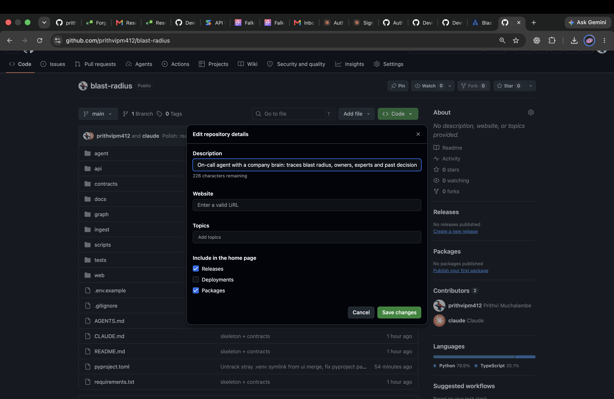
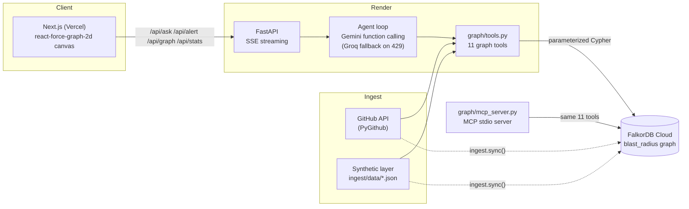
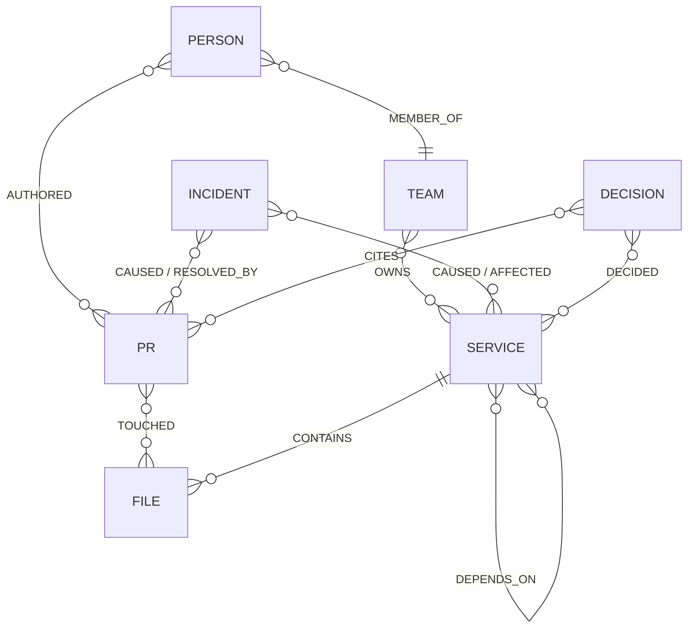

# Blast Radius

An on-call agent with a company brain — when a service fails, it traces the blast radius, finds owners and experts, surfaces past incidents and decisions, and drafts the incident issue, all over a FalkorDB knowledge graph.

[**Live demo**](https://blast-radius-gray-two.vercel.app) · [**API**](https://blast-radius-api-nawe.onrender.com/api/health) · [**Demo video**](https://youtu.be/r24UHYV3JOQ) · Tracks: **01 — Agents That Act on Connected Data** + **03 — Company Brain**

Built for **Graph Hacks** (WeMakeDevs x FalkorDB).



---

## The problem

When a service goes down at 2am, the on-call engineer doesn't just need "is it up" — they need *what breaks downstream*, *who owns the broken thing*, *who actually knows this code*, *has this happened before*, and *why was it built this way*. That information is scattered across Slack, runbooks, CODEOWNERS, old postmortems, and tribal memory. Answering it well, under pressure, usually means paging three people and waiting.

## Why a graph

Every one of those questions is a multi-hop traversal, not a lookup: "what breaks" is a transitive dependency walk, "who owns it" is team → person via membership, "has this happened before" is incident → service → neighboring services. A vector index over documents can retrieve *text that sounds related*; it can't walk `Service -[:DEPENDS_ON]-> Service` or `Team -[:OWNS]-> Service` and return a structurally correct answer. The app ships both modes side by side — click **Compare answers** to send the same question through `mode="graph"` (FalkorDB traversals) and `mode="rag"` (plain BM25 text retrieval, no entities, no relationships) at once. Ask "what breaks if cartservice goes down" and the RAG baseline has no way to know; the graph mode walks incoming `DEPENDS_ON` edges and names the services.

## How it works

```
alert on a service
  → blast_radius        (who breaks: incoming DEPENDS_ON traversal)
  → find_owners          (Team -[:OWNS]-> Service -> Person via MEMBER_OF)
  → find_experts          (recent human PR authors on the service's files)
  → similar_incidents    (past Incidents on this service or a 1-hop neighbor)
  → trace_decision       (ADRs governing this service + what they cite)
  → create_incident_issue (dry run by default — drafts, never files)
  → answer, grounded only in the above, with every claim cited to a source_url
```

Every tool call returns `{data, cypher, params, path}` — the exact parameterized Cypher that ran and the graph nodes/edges it touched. The UI's trace panel shows both for every step, so nothing the agent says is a black box. `POST /api/alert` runs this whole playbook automatically; `POST /api/ask` lets the agent choose tools freely for a free-form question (max 8 tool-call steps).

## Architecture



The same 11 functions in `graph/tools.py` back three surfaces: the HTTP API (`api/`), the LLM agent loop (`agent/`), and a standalone MCP server (`graph/mcp_server.py`) so any MCP-aware client can call `blast_radius`, `find_owners`, etc. directly against the same graph.

## Graph data model

Live graph (last synced from the API above): **2,136 nodes**, **8,686 edges** — 12 services, 282 people, 241 PRs, 300 commits, 200 issues, 18 incidents, 8 decisions, 6 teams.

### Node labels

| label | count | key properties | real / synthetic |
|---|---|---|---|
| `Person` | 282 | `github_login`, `role` | real contributors + synthetic on-call engineers |
| `Team` | 6 | `team_kind` (`oncall`\|`github`), `pager_channel` | both kinds coexist |
| `Service` | 12 | `language`, `description`, `criticality` (PageRank) | real |
| `Repo` | 1 | `default_branch` | real |
| `File` | 1,025 | `path` | real |
| `Commit` | 300 | `sha`, `message`, `authored_at` | real |
| `PR` | 241 | `number`, `merged_at`, `body` | real |
| `Issue` | 200 | `number`, `state`, `labels` | real (ingested) + synthetic (agent-filed) |
| `Incident` | 18 | `severity`, `started_at`, `resolved_at` | synthetic |
| `Decision` | 8 | `status`, `context`, `decided_at` | synthetic (ADRs) |
| `Doc` | 43 | `kind` (`readme`\|`runbook`\|`postmortem`) | real READMEs + synthetic runbooks |
| `SyncMeta` | 1 | `last_synced_at` | operational, excluded from stats/UI |

### Edge types

| edge | direction | meaning |
|---|---|---|
| `DEPENDS_ON` | `Service → Service` | caller depends on callee (real call graph) |
| `OWNS` | `Team/Person → Service/File` | on-call ownership (synthetic) or CODEOWNERS (real) |
| `MEMBER_OF` | `Person → Team` | team membership |
| `AUTHORED` | `Person → PR/Issue/Commit` | real authorship |
| `TOUCHED` | `PR/Commit → File` | real diff evidence |
| `CONTAINS` | `Repo/Service → File` | real, by path |
| `CAUSED` / `AFFECTED` | `Incident → Service/PR` | fabricated incident narrative (always `synthetic=true`) |
| `RESOLVED_BY` | `Incident → PR` (synthetic) / `Issue → PR` (real) | fix attribution |
| `DECIDED` | `Decision → Service` | ADR applies to this service (synthetic) |
| `CITES` | `Decision → PR/Doc`, `Incident → Decision` | narrative citation (always `synthetic=true`) |
| `MENTIONS` | `Issue/Doc → Service` | text reference |



Full reference, including `synthetic`/`source_url` rules per label and edge: [`contracts/schema.md`](contracts/schema.md).

## Key Cypher queries & graph algorithms

All values are passed as parameters — never string-interpolated. The full set (search, owners, decisions, sync/upsert queries) is in [`docs/queries.md`](docs/queries.md); the most important ones:

**Blast radius** — incoming variable-length dependency traversal, capped by depth:
```cypher
MATCH (s:Service {id: $service})
OPTIONAL MATCH (a:Service)
WHERE a.id <> s.id
WITH s, a, shortestPath((s)<-[:DEPENDS_ON*]-(a)) AS p
RETURN s, CASE WHEN length(p) <= $max_depth THEN p ELSE null END,
       CASE WHEN length(p) <= $max_depth THEN a ELSE null END
LIMIT $limit
```

**Failure path** — shortest path between two services, with an undirected fallback when no directed chain exists:
```cypher
OPTIONAL MATCH (a:Service {id: $from_service})
OPTIONAL MATCH (b:Service {id: $to_service})
WITH a, b, shortestPath((a)<-[:DEPENDS_ON*]-(b)) AS p
OPTIONAL MATCH connected=(a)-[:DEPENDS_ON*]-(b)
RETURN a, b, p, length(connected) LIMIT $limit
```

**Experts** — recent merged-PR authors reached through the service's files, ranked and bot-filtered in Python:
```cypher
MATCH (s:Service {id: $service})
OPTIONAL MATCH p=(s)-[:CONTAINS]->(f:File)<-[:TOUCHED]-(pr:PR)<-[:AUTHORED]-(person:Person)
WHERE pr.merged_at >= $cutoff AND pr.merged_at <= $now
RETURN s, p ORDER BY pr.merged_at DESC, person.id, pr.id LIMIT $limit
```

**Similar incidents** — same-service incidents plus one-hop dependency neighbors:
```cypher
MATCH (s:Service {id: $service})
OPTIONAL MATCH neighborhood=(s)-[:DEPENDS_ON*0..1]-(near:Service)
OPTIONAL MATCH evidence=(i:Incident)-[:CAUSED|AFFECTED]->(near)
RETURN s, neighborhood, evidence ORDER BY i.started_at DESC, i.id LIMIT $limit
```

**Decision trace** — ADRs governing a service, their cited PRs, and incidents that cite them back:
```cypher
MATCH (s:Service {id: $service})
OPTIONAL MATCH decision=(d:Decision)-[:DECIDED]->(s)
OPTIONAL MATCH citation=(d)-[:CITES]->(pr:PR)
OPTIONAL MATCH context=(i:Incident)-[:CITES]->(d)
RETURN s, decision, citation, context ORDER BY d.decided_at DESC, d.id LIMIT $limit
```

**PageRank** (`critical_services` — sizes service nodes by structural importance, persists `Service.criticality`):
```cypher
CALL algo.pageRank($label, $relationship)
YIELD node, score
SET node.criticality = score
WITH node, score
OPTIONAL MATCH p=(node)-[:DEPENDS_ON]->(:Service)
RETURN node, score, p ORDER BY score DESC, node.id LIMIT $limit
```

**Betweenness centrality** (`single_points_of_failure` — finds structural chokepoints):
```cypher
CALL algo.betweenness($config)
YIELD node, score
OPTIONAL MATCH p=(node)-[:DEPENDS_ON]->(:Service)
RETURN node, score, p ORDER BY score DESC, node.id LIMIT $limit
```

**Community detection** (`team_clusters` — label propagation, cross-referenced with real `OWNS` edges to label each cluster):
```cypher
CALL algo.labelPropagation($config)
YIELD node, communityId
OPTIONAL MATCH p=(node)-[:DEPENDS_ON]->(:Service)
OPTIONAL MATCH ownership=(t:Team)-[:OWNS]->(node)
RETURN node, communityId, p, ownership ORDER BY node.id LIMIT $limit
```

All three algorithms prefer FalkorDB's native procedures (checked at runtime via `CALL dbms.procedures()`) and fall back to a documented NetworkX/Python approximation only if a procedure is missing — see `graph/algorithms.py` and [`docs/queries.md`](docs/queries.md).

## Data sources

- **Real**: [`GoogleCloudPlatform/microservices-demo`](https://github.com/GoogleCloudPlatform/microservices-demo) (Online Boutique, Apache-2.0), pulled live via the GitHub API — commits, PRs, issues, contributors, CODEOWNERS, and READMEs. Service dependency edges are hand-curated from the repo's real gRPC call graph (its own architecture docs), not invented.
- **Synthetic** (clearly flagged `synthetic: true` on every node/edge per [`contracts/schema.md`](contracts/schema.md), rendered with dashed outlines in the UI): on-call teams, on-call roles, incidents, and architectural decisions (ADRs). These exist because the real repo has no on-call rotation or incident history to pull from — they're hand-curated narrative, never presented as verified fact, and `source_url` is the literal string `"synthetic"` so the UI never renders a fake citation link.
- No private data of any kind is used.

## Run locally

```bash
git clone https://github.com/prithvipm412/blast-radius.git
cd blast-radius

# Backend (Python 3.12)
python3.12 -m venv .venv
source .venv/bin/activate
pip install -e ".[dev]"   # or: pip install -r requirements.txt

# Environment
cp .env.example .env
# fill in FALKORDB_*, LLM_PROVIDER (gemini or groq) + its API key, GITHUB_TOKEN

# FalkorDB — either run it locally via Docker...
docker run -p 6379:6379 -it --rm falkordb/falkordb:latest
# ...or point FALKORDB_* at a FalkorDB Cloud instance instead.

# Load the graph (GitHub data + synthetic layer)
python -m ingest.load --all

# Run the API
uvicorn api.main:app --reload --port 8000

# In a second terminal: the frontend
cd web
npm install
cp ../.env.example .env.local   # keep only NEXT_PUBLIC_API_URL
npm run dev
```

Sanity-check the DB connection any time with `python scripts/check_db.py` (should print `OK`).

**Deploying your own copy** (Render + Vercel + FalkorDB Cloud, click-by-click): see [`DEPLOY.md`](DEPLOY.md).

## Tech stack

- **Backend**: Python 3.12, FastAPI, `sse-starlette` (SSE streaming), FalkorDB (Redis-based graph DB) via `falkordb`, `google-genai` (Gemini function calling) with a Groq OpenAI-compatible fallback, PyGithub, official MCP SDK
- **Frontend**: Next.js (App Router), TypeScript, Tailwind CSS, Framer Motion, `react-force-graph-2d`, `react-markdown`
- **Infra**: FalkorDB Cloud, Render (API), Vercel (frontend)

## AI assistance disclosure

Built with **Claude Code** and **OpenAI Codex** as coding assistants — one lead agent (Claude Code) plus parallel agents (Codex) working in separate git worktrees on `ingest/`, `graph/`, and `web/` against a shared set of contracts (`contracts/schema.md`, `tools.md`, `api.md`). I designed the architecture, defined the graph data model and contracts, and reviewed and tested the resulting queries and agent behavior myself — I can explain every design decision in this repo.

## Team

**Prithvi** — [github.com/prithvipm412](https://github.com/prithvipm412)

## License

MIT — see [LICENSE](LICENSE).
